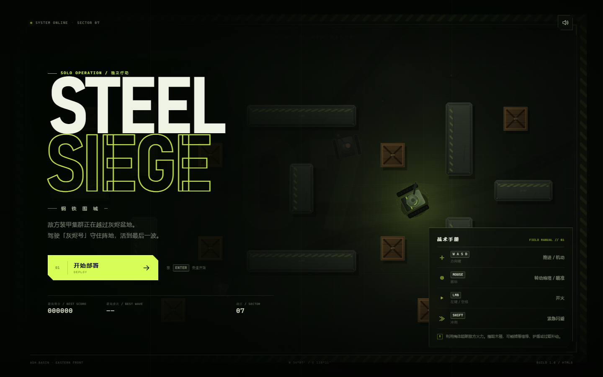
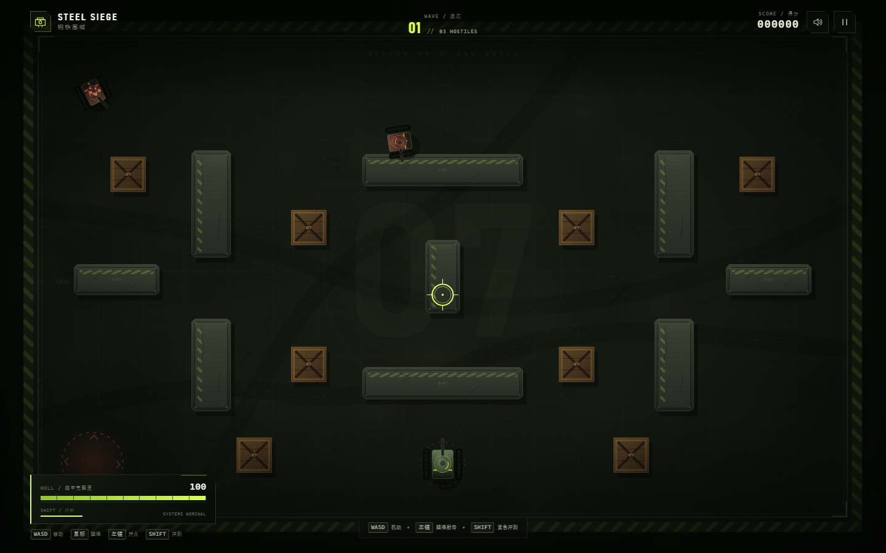

# 钢铁围城 · STEEL SIEGE

一款使用原生 **HTML5 Canvas** 制作的俯视角坦克生存街机游戏。无框架、无外部素材、无构建步骤，打开 `index.html` 即玩。



## 游戏特色

- **无尽波次**：敌人会随着波次增多而变强，类型包括掠袭者、突击者、重装者与远程猎杀者
- **TITAN 首领战**：每 5 波出现重装首领，拥有独立血条、双联主炮与环形弹幕
- **战术掩体**：混凝土阻挡火力，木质补给箱可被击碎
- **随机补给**：装甲维修、能量护盾、火力过载
- **连杀倍率**：连续击毁敌人可提升得分倍率
- **完整视听反馈**：屏幕震动、爆炸粒子、弹道拖尾、合成音效
- **桌面 & 移动端**：键盘鼠标操作，手机横屏可使用双摇杆
- **本地存档**：最高得分与最高波次自动保存在浏览器



## 操作

| 操作 | 按键 |
| --- | --- |
| 移动 | `W A S D` / 方向键 |
| 瞄准 | 鼠标 |
| 开火 | 鼠标左键 / `Space` |
| 紧急冲刺 | `Shift` |
| 暂停 | `P` / `Esc` |
| 静音 | `M` |

手机端请横屏游玩：左摇杆移动，右摇杆瞄准并自动开火，中间按钮冲刺。

## 本地运行

```bash
git clone https://github.com/shark-yy/tank-battle.git
cd tank-battle
```

直接双击 `index.html`，或启动任意静态文件服务器：

```bash
npx serve .
```

## 技术

- 原生 JavaScript（无依赖）
- Canvas 2D 渲染与固定世界坐标缩放
- Web Audio API 实时合成音效
- 本地 `localStorage` 保存记录

## 文件结构

```
.
├── index.html    # 页面结构与 HUD
├── styles.css    # 界面、响应式布局与视觉特效
├── game.js       # 游戏循环、AI、碰撞、渲染与音效
├── favicon.svg
└── assets/       # README 截图
```
